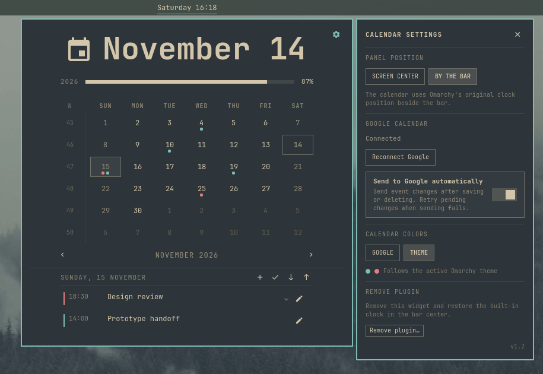

# Google Calendar OAuth — No Google Cloud Project

**Version 1.2 · [Русский](README.md)**

Your Google Calendar in the Omarchy bar, with **Google OAuth sign-in through GNOME Online Accounts**. No personal Google Cloud Console project or OAuth client registration is required. This plugin connects to **Google Calendar**, not iCloud.



The screenshot uses demonstration data.

## Features

- Replaces the stock central clock with a themed month grid and agenda.
- Reads the selected account's primary Google calendar; creates, edits and deletes events.
- Automatically sends saved changes, with an opt-out switch and a durable local queue.
- Event duration from 1 to 10080 minutes; Google default reminders, none, or 1–40320 minutes before the event.
- Supported recurring events and occurrences; revision checks reject stale edits.
- An uncertain create result pauses retries instead of blindly creating another event.
- Russian and English UI, plus inherited translations with English fallback.

Incoming changes are pulled at startup and every 30 minutes, or immediately with `↓`. This is separate from automatic outgoing sync. Google Tasks and the entire Google Calendar web interface are not included.

## Install

Tested on Omarchy 4.5 / Quickshell 0.3.2, Linux x86-64. An ARM64 Caldir archive is pinned, but its UI has not been tested here.

```bash
omarchy pkg add gnome-online-accounts gnome-online-accounts-gtk python-gobject jq rust bubblewrap git curl base-devel
omarchy plugin add https://github.com/i4w7w4a/omarchy-google-calendar-oauth.git
```

Leave the new plugin disabled until setup. The following command **replaces the stock central clock** and enables automatic sending for a fresh installation. It backs up `shell.json` and any previous plugin copy under `~/.local/state/omarchy-project/backups/`; existing preferences are kept on updates. The first provider build takes a few minutes:

```bash
~/.config/omarchy/plugins/re_pick.google-calendar-clock/install-local
```

Open the clock, choose **Connect Google**, then **Google → Sign In**. Select the Calendar permission on Google's consent page and complete sign-in. You do not need a Google Cloud project, a client ID, or an iCloud account.

The system browser is used by default. An optional `~/.config/omarchy-calendar/browser.json` selects a browser for sign-in, for example:

```json
{"executable":"/usr/bin/yandex-browser-stable","arguments":["--profile-directory=Default"]}
```

Yandex Browser is not a dependency.

## Update / remove

```bash
omarchy plugin update re_pick.google-calendar-clock
~/.config/omarchy/plugins/re_pick.google-calendar-clock/setup --binaries-only
```

For a development checkout outside the installed plugin directory, use `git pull --ff-only` and `./install-local`. Update an installed Git checkout in place; the installer refuses to overwrite it with a different checkout.

```bash
~/.config/omarchy/plugins/re_pick.google-calendar-clock/uninstall
```

The uninstaller restores the stock clock and archives the plugin. It keeps your events, queue and Google connection. Manage GNOME's Google authorization separately in your Google account.

## Authentication and privacy

GNOME Online Accounts handles OAuth and retains long-lived credentials in the system secret store. Its Google consent screen may also request Gmail, contacts, tasks and profile permissions. **This plugin uses only the Google Calendar API.** It obtains a short-lived access token for one bounded Caldir operation, stores it temporarily with mode `0600`, and removes it afterward. It never copies the refresh token or client secret into the plugin. No Caldir.org OAuth relay is used.

A `403 insufficientPermissions` response means Calendar was not granted: reconnect Google in Online Accounts, select Calendar on the consent screen, and run Connect Google again.

The dedicated profile is under `~/.config/omarchy-calendar/`, events under `~/.local/share/omarchy-calendar/calendars/`, and queue/cache and reminder deduplication state under `~/.local/state/omarchy-calendar/`. None is included in this repository. Reminder contents are passed through standard input and the user's D-Bus session, without event names or links in process arguments. Omarchy plugins run as your user inside the shell; the plugin itself is not sandboxed. See [SECURITY.md](SECURITY.md).

## Runtime and validation

Caldir 0.14.9 is pinned at `bb853f0266629fa8eab3d8103dced92e8fbf71f0`; [runtime.json](runtime.json) records URLs and SHA-256 values. The official CLI archive is hash-checked. The Google provider is built from pinned source with [a single-insert patch](patches/caldir-single-insert.patch), avoiding internal POST retries and redirects.

`build-runtime` verifies source and patch hashes, fetches dependencies with `cargo fetch --locked`, then builds and tests without network or home data in Bubblewrap, using up to four low-priority jobs. It needs system Rust/Cargo 1.97 or later. `BUILD-INFO.json` records the resulting hashes; bit-for-bit build reproducibility is not claimed.

```bash
TEST_CALDIR_BIN_DIR="$HOME/.local/share/omarchy-calendar/bin" python -B -m unittest discover -s tests
node --test tests/test_model.js
node i18n/validate.js
omarchy plugin validate .
```

The first version passed a real Google create/edit/delete roundtrip, including reading back event duration and reminders. Automated tests use fixtures, not a real account. Explicit zero-minute Google reminders are unavailable due to a Caldir limitation; unsupported edits and moving a recurring series with modified occurrences are rejected explicitly.

## Credits

Derived from [NachoRodriguezM's Omarchy Google Calendar and Clock](https://github.com/NachoRodriguezM/omarchy-google-calendar-clock/tree/fc3285de075d9db8060107e7b9cd2431ec31e1b1) and Omarchy's built-in clock. Original notices are retained. [MIT](LICENSE) · [Attribution](NOTICE.md) · [Pinned sources](PROVENANCE.json).
