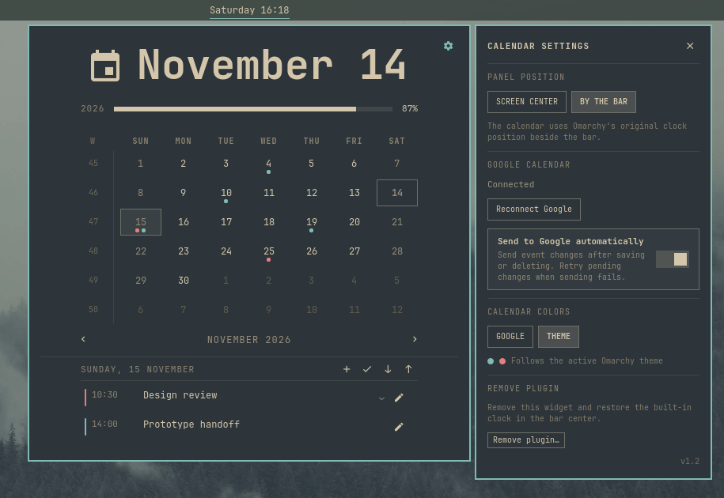

# Google Calendar OAuth — No Google Cloud Project

**Версия 1.2 · [English](README.en.md)**

Google Calendar в центральной панели Omarchy: вход через **Google OAuth с помощью GNOME Online Accounts**, автоматическая отправка событий, выбор длительности и напоминания. **Собственный проект в Google Cloud Console не требуется.** Это интеграция именно с Google Calendar; iCloud не используется и не поддерживается.



На скриншоте — демонстрационные данные.

## Возможности

- Часы и календарь на месте штатных центральных часов, с цветами текущей темы Omarchy.
- Чтение основного Google-календаря выбранного аккаунта, создание, изменение и удаление событий.
- Автоматическая отправка после сохранения или удаления; переключатель в настройках позволяет её выключить.
- Длительность от 1 до 10080 минут. Напоминание по умолчанию Google, без уведомления либо за 1–40320 минут.
- Повторяющиеся события и отдельные экземпляры в поддерживаемых случаях. Проверка ревизии защищает от сохранения устаревшей формы.
- Локальная очередь при сбое. Неопределённый результат создания приостанавливает повтор, чтобы не создавать дубли.
- Русский и английский интерфейс; прежние переводы других языков сохранены с английским запасным вариантом.

Обновления из Google загружаются на старте и каждые 30 минут, а кнопка `↓` запускает загрузку сразу. Автоматическая отправка работает отдельно от этого расписания. Google Tasks и полный интерфейс веб-календаря в плагин не входят.

## Установка

Проверено на Omarchy 4.5 / Quickshell 0.3.2, Linux x86-64. Для ARM64 закреплён архив Caldir, но интерфейс на этой архитектуре не проверялся.

Нужны системные GNOME Online Accounts, его GTK-окно и зависимости сборки:

```bash
omarchy pkg add gnome-online-accounts gnome-online-accounts-gtk python-gobject jq rust bubblewrap git curl base-devel
```

Добавьте плагин, пока не включая его:

```bash
omarchy plugin add https://github.com/i4w7w4a/omarchy-google-calendar-oauth.git
```

Следующая команда **заменит штатные центральные часы** и включит автоматическую отправку для новой установки. Перед изменением она сохранит `shell.json` и прежнюю копию плагина в `~/.local/state/omarchy-project/backups/`. При обновлении существующие настройки сохраняются. Первичная сборка провайдера занимает несколько минут:

```bash
~/.config/omarchy/plugins/re_pick.google-calendar-clock/install-local
```

Откройте календарь, нажмите **«Подключить Google»**, затем **Google → Sign In**. На странице согласия Google явно отметьте разрешение Calendar и завершите вход. Проект Google Cloud, ручной OAuth client ID и клиент iCloud не нужны.

По умолчанию открывается системный браузер. Необязательный файл `~/.config/omarchy-calendar/browser.json` позволяет выбрать отдельный браузер и профиль для входа; пример:

```json
{"executable":"/usr/bin/yandex-browser-stable","arguments":["--profile-directory=Default"]}
```

Это локальная настройка пользователя; Яндекс Браузер не является зависимостью плагина.

## Обновление и удаление

```bash
omarchy plugin update re_pick.google-calendar-clock
~/.config/omarchy/plugins/re_pick.google-calendar-clock/setup --binaries-only
```

Для исходника, клонированного вне каталога плагинов: `git pull --ff-only`, затем `./install-local`. Существующую установленную Git-копию обновляйте на месте; установщик не перезаписывает её другим checkout.

```bash
~/.config/omarchy/plugins/re_pick.google-calendar-clock/uninstall
```

Удаление возвращает штатные часы и переносит код плагина в резервную копию. События, очередь и подключение Google сохраняются. Доступ GNOME к аккаунту отдельно управляется на стороне Google.

## OAuth и данные

GNOME Online Accounts выполняет OAuth и хранит долгоживущие учётные данные в системном хранилище. Он может запросить также Gmail, контакты, задачи и профиль; **этот плагин использует только API Google Calendar**. Короткоживущий access token передаётся Caldir во временных файлах `0600` для одной ограниченной операции и затем удаляется. Refresh token и client secret в плагин не копируются. Caldir.org и другие OAuth-посредники не используются.

Если Google отвечает `403 insufficientPermissions`, согласие Calendar не было выдано: переподключите Google в Online Accounts с отмеченным Calendar и снова нажмите «Подключить Google».

Профиль: `~/.config/omarchy-calendar/`. События: `~/.local/share/omarchy-calendar/calendars/`. Очередь, кэш и отметки отправленных напоминаний: `~/.local/state/omarchy-calendar/`. Они не входят в репозиторий. Содержимое напоминаний передаётся через стандартный ввод и D-Bus пользовательского сеанса, без названий событий и ссылок в аргументах процессов. Плагин работает с правами вашего пользователя внутри Omarchy Shell; это не отдельная песочница. [Подробности безопасности](SECURITY.md).

## Закреплённый runtime и проверки

Caldir 0.14.9: `bb853f0266629fa8eab3d8103dced92e8fbf71f0`. URL и SHA-256 — в [runtime.json](runtime.json). CLI скачивается из официального релиза с проверкой хеша. Google provider собирается из закреплённого исходника с [патчем однократного создания](patches/caldir-single-insert.patch): без скрытых повторных POST и перенаправлений.

`build-runtime` проверяет архив и патч до использования, выполняет `cargo fetch --locked`, затем сборку и тесты без сети и домашних данных в Bubblewrap, не более четырёх задач с пониженным приоритетом. Нужен системный Rust/Cargo не ниже 1.97. `BUILD-INFO.json` записывает фактические хеши. Побайтовая воспроизводимость бинарников не заявляется.

```bash
TEST_CALDIR_BIN_DIR="$HOME/.local/share/omarchy-calendar/bin" python -B -m unittest discover -s tests
node --test tests/test_model.js
node i18n/validate.js
omarchy plugin validate .
```

Первичная версия проверена реальным циклом создания, изменения и удаления временного Google-события; длительность и напоминание прочитаны обратно через API. Автотесты используют искусственные данные, не настоящий аккаунт. Нулевое явное Google-напоминание не предлагается из-за ограничения Caldir; несовместимые изменения и перенос времени серии с изменёнными экземплярами отклоняются явно.

## Происхождение

Производная работа на основе [Omarchy Google Calendar and Clock](https://github.com/NachoRodriguezM/omarchy-google-calendar-clock/tree/fc3285de075d9db8060107e7b9cd2431ec31e1b1) от NachoRodriguezM и штатных часов Omarchy. Авторские уведомления сохранены. [MIT](LICENSE) · [Атрибуция](NOTICE.md) · [Полные исходные версии](PROVENANCE.json).
